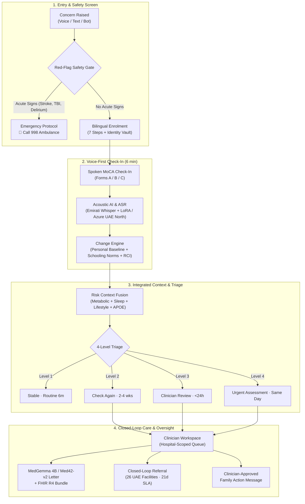
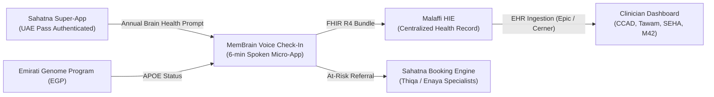

# MemBrain: Protecting Brain Health Earlier

[](https://github.com/teamcerebrospark/membrain)
[](#-ecosystem-integration-sahatna-صحتنا--malaffi-compatibility)
[](https://github.com/teamcerebrospark/membrain)
[](https://github.com/teamcerebrospark/membrain)
[-blue?style=for-the-badge)](https://github.com/teamcerebrospark/membrain)
[](https://github.com/teamcerebrospark/membrain)
[](https://github.com/teamcerebrospark/membrain/releases/download/android-latest/MemBrain.apk)
[](#)

> **Team Cerebro Spark** · *Future Health Digital Innovation Challenge* · **[Population Health] Protecting Brain Health Earlier**  
> **Live Site:** [teamcerebrospark.github.io/membrain/](https://teamcerebrospark.github.io/membrain/) · **Arabic Portal:** [teamcerebrospark.github.io/membrain/ar/](https://teamcerebrospark.github.io/membrain/ar/) · **Android APK:** [Download v0.5.0](https://github.com/teamcerebrospark/membrain/releases/download/android-latest/MemBrain.apk)

---

## 📌 Executive Summary

**MemBrain** is a culturally calibrated, voice-first cognitive and functional monitoring platform designed for adults aged 50–75 in Abu Dhabi and the UAE. Operating across web, mobile (Android APK / iOS Coming Soon), and chat channels—and architected for native integration into Abu Dhabi's **Sahatna (صحتنا)** digital health super-app—MemBrain enables early detection of neurocognitive decline through short, 6-minute spoken check-ins in Emirati and Gulf Arabic dialects as well as English.

Rather than relying on one-off testing, MemBrain builds a **longitudinal personal baseline**, separates genuine cognitive change from normal day-to-day variance using practice-adjusted Reliable Change Index (RCI) statistics, and enriches assessments with metabolic, lifestyle, sleep, informant, and consent-gated genomic context.

> [!IMPORTANT]
> **Clinical Governance Mandate:** **MemBrain identifies risk and change over time. It never diagnoses.** AI models summarize, fact-check, and suggest triage priorities, but **never triage or diagnose alone**. Any abnormal, rapidly deteriorating, or high-risk finding is placed in a qualified clinician queue for human review within 24 hours before any recommendation reaches the family. All data in this repository is synthetic and privacy-preserving.

---

## 🎯 Alignment with the Innovation Challenge

MemBrain was built from the ground up to solve the **[Population Health] Protecting Brain Health Earlier** challenge. The table below details how MemBrain’s architecture satisfies every desired outcome set out in the challenge brief:

| Challenge Desired Outcome | The Problem Addressed | MemBrain’s Direct Implementation | Status |
| :--- | :--- | :--- | :---: |
| **1. Culturally Valid & Accessible Assessment** | Single-point, Western-centric cognitive tests mislead when applied to local UAE populations due to language, dialect, education level, and cultural nuances. | • Spoken, 6-minute check-in running on fine-tuned **Emirati Whisper-small + LoRA** and Azure AI Speech (UAE North).<br>• Fully bilingual (Modern Standard Arabic, Gulf dialects, English).<br>• Calibrated across UAE education tiers (*no formal schooling, primary $\le$6y, secondary 7–12y, higher >12y*).<br>• Pre-check sensory gates (hearing aids, reading glasses, room noise db, and digital comfort). | **Live** |
| **2. Longitudinal Change Detection** | Gradual cognitive decline is masked by normal ageing or confounded by test practice effects (learning the questions). | • **Personal Baseline Engine**: Compares each check-in against the person's own historical trajectory.<br>• Uses **Reliable Change Index (RCI)** with practice-effect correction and 3 equated parallel forms (A, B, C).<br>• 4-tier longitudinal protocol: Baseline 1 $\to$ Baseline 2 (Day 14) $\to$ Follow-up (Day 84 / 3 months) $\to$ Routine (every 6 months). | **Live** |
| **3. Integrated Risk Context** | Cognitive markers remain isolated from cardiometabolic, sleep, lifestyle, and genetic determinants. | • **Health & Context Matrix**: Captures Blood Pressure (SBP/DBP), HbA1c (Type 2 diabetes), LDL cholesterol, BMI, physical activity, smoking, and social isolation.<br>• **Consent-Gated Genomics**: Integrates external **APOE-e4** status (from the Emirati Genome Program) under strict consent; genomic data is clinician-only and never an automated alert trigger. | **Live** |
| **4. Personalized Prevention & Timely Clinical Care** | Patients receive opaque clinical reports with no actionable guidance, or get lost in fragmented referral handoffs. | • **Prevention Engine**: Translates risk findings into personalized, actionable lifestyle steps based on the **Lancet Commission 2024 guidelines**.<br>• **Closed-Loop Referral Navigator**: Matches at-risk participants to 26 registered UAE memory/geriatric facilities (CCAD, Tawam, Rashid Hospital, etc.) filtered by Emirate, language, and insurance (Thiqa, Enaya, Saada). | **Live** |
| **5. Safety and Human Oversight** | Unsupervised AI can hallucinate diagnostic claims, cause false panic, or miss life-threatening acute medical emergencies. | • **Safety Screen First**: Immediate acute red-flag screening (sudden onset, fluctuating delirium, stroke signs, falls/TBI $\to$ emergency 998 protocol).<br>• **Human-in-the-Loop**: Clinician workspace with role-based access; every referral and family message must be approved by a human clinician.<br>• **24-Hour Review Target**: Urgent cases reviewed within 24 hours. | **Live** |
| **6. Validation & Local Population Performance** | Screening algorithms lack local real-world validation across age bands, dialects, and education brackets. | • **Interactive Cohort & Validation Dashboard** (`/clinician/validation/`): Real-time metrics on completion rates, sensitivity, specificity, test-retest reliability, and agreement with gold-standard clinic MoCA.<br>• Full engine parity: **478/478** identical evaluations across Python and TypeScript. | **Live** |

---

## 🏗️ System Architecture & Clinical Pathway

MemBrain operates as a three-tier, privacy-first healthcare architecture designed to run on-device or within UAE borders:



### Architectural Highlights
1. **Edge-First & Zero Data Egress:** Spoken check-in transcripts can be scored 100% locally on the device (Android APK / Browser WebAssembly) with no voice recording leaving the user's phone unless explicitly consented.
2. **Identity Vault (Cryptographic Pseudonymization):** Patient PII (Name, National ID, Phone) is stored separately from health records. Clinicians and researchers interact with pseudonymous IDs (e.g. `MB-7182`). Re-identification requires documented clinical justification logged in an immutable audit trail (`audit.jsonl`).
3. **In-Country Sovereignty:** Cloud endpoints and server-side speech recognition run inside **Azure UAE North (Abu Dhabi/Dubai)** or local hospital infrastructure.

---

## ✨ Current State: What Works Today

| Module | Location | Description & Capabilities |
| :--- | :--- | :--- |
| **Spoken MoCA Check-In** | `site/components/checkin/` | 6-minute voice check-in covering orientation, word recall, story memory, semantic fluency, and judgement. Includes 3 parallel equated forms (A/B/C) to prevent recall bias. |
| **7-Step Participant Enrolment** | `site/components/clinician/enrol/` | Comprehensive bilingual (AR/EN) coordinator form: route, identity vault, profile, consent per data type, informant profile (IQCODE-16), health context, and review. |
| **Change Engine** | `membrain/change.py` | Multi-session baseline tracker with practice-adjusted Reliable Change Index (RCI) and Exponentially Weighted Moving Average (EWMA) trend analysis. |
| **Scoring & Norms Engine** | `membrain/scoring.py` | Dual Arabic/English NLP scoring calibrated against normative groups stratified by age and UAE schooling. |
| **Closed-Loop Referral Navigator** | `site/components/clinician/referrals/` | Tracks referral progression (`draft` $\to$ `sent` $\to$ `accepted` $\to$ `seen` $\to$ `closed`) across 26 UAE memory centers with a **21-day target SLA** and stalled-case alerts. |
| **Clinician Workspace** | `site/components/clinician/` | Hospital-scoped queue with prioritized triage cards, MoCA breakdown, fact-checked AI referral drafts (MedGemma / Med42-v2), and one-click FHIR R4 export. |
| **Informant Questionnaire** | `site/components/informant/` | Short 10-question everyday change survey (Arabic/English) for family members or household helpers to identify functional decline hidden by home care. |
| **Prevention Plan Generator** | `membrain/prevention.py` | Evidence-based lifestyle and cardiometabolic recommendations grounded in the Lancet Commission 2024 dementia prevention guidelines. |
| **Telegram Bot** | `api/telegram.py` | Conversational bot for raising concerns, voice note intake, and reading back extracted clinical facts with evidence quotes. |
| **Android Application** | `mobile/`, `site/components/app/` | Offline-capable Android APK built with Capacitor, featuring standalone check-ins, local SQLite cache, and clinic map. |

---

## 🇦🇪 Ecosystem Integration: Sahatna (صحتنا) & Malaffi Compatibility

MemBrain is architected not as an isolated point solution, but as an **embeddable cognitive intelligence and screening module for Sahatna (صحتنا)**—Abu Dhabi’s unified AI-powered digital health super-app launched by the Department of Health (DoH) and powered by Malaffi.



| Sahatna Integration Pillar | Technical & Clinical Realization in MemBrain |
| :--- | :--- |
| **Annual Brain Health Pathway** | Designed to embed as a lightweight micro-app/SDK within Sahatna, prompting eligible citizens and residents aged 50–75 for an annual 6-minute spoken check-in in Emirati Arabic or English. |
| **Direct Malaffi Data Pipeline** | Outputs native **HL7 FHIR R4B** resources (`membrain/fhir.py`): `Patient`, `Observation`, `Consent`, `RiskAssessment`, and `DocumentReference` compatible with Malaffi, making longitudinal cognitive trajectories instantly accessible to physicians across SEHA, CCAD, M42, and Burjeel. |
| **UAE Pass & Identity Vault** | Pre-architected for single sign-on (SSO) with **UAE Pass**. Emirates IDs (`784-XXXX-XXXXXXX-X`) are cryptographically isolated in MemBrain's Identity Vault, allowing analytics and AI models to run exclusively on pseudonymous tokens (`MB-XXXX`). |
| **Emirati Genome Program (EGP) Alignment** | Connects to Sahatna's genomic wellness capabilities via MemBrain's **consent-gated APOE genetic context module** (`membrain/genomics.py`), importing pre-existing EGP data to personalize prevention pathways without redundant testing. |
| **Closed-Loop Scheduling & Referral** | Direct interface with Sahatna’s provider directory across 26 UAE clinics/hospitals (Cleveland Clinic Abu Dhabi, Tawam, Rashid Hospital, etc.), allowing at-risk users to convert an alert directly into an approved specialist consultation under **Thiqa**, **Saada**, or **Enaya**. |
| **Family & Caregiver Support (Tawawoon)** | Leverages Sahatna’s multi-generational family health management through MemBrain’s **Informant Survey**, enabling adult children or household helpers to report functional changes noticed in elderly family members. |
| **In-Country Sovereignty & Compliance** | Zero data egress on-device transcript scoring combined with cloud hosting in **Azure UAE North (Abu Dhabi / Dubai)** satisfies all DoH standards and UAE Federal Decree-Law No. 45/2021 regarding health data protection. |

---

## 🔮 Roadmap: "Coming Soon" Features & Challenge Impact

MemBrain is designed to expand continuously. The following upcoming features on our roadmap are deeply integrated into the **Protecting Brain Health Earlier** mission:

### 1. Telegram & WhatsApp Autonomous Bots (*Coming Soon*)
* **Challenge Fit:** *Accessible, Low-Friction Engagement across UAE Demographics.*
* **What it adds:** While the Telegram bot backend is operational, direct WhatsApp Business API integration is being finalized. WhatsApp is the primary communication channel in the UAE. This allows seniors and families to receive scheduled 6-month check-in reminders, complete voice-note check-ins directly inside WhatsApp without downloading an app, and receive clinician-approved next-step instructions.

### 2. iOS Native App on TestFlight (*Coming Soon*)
* **Challenge Fit:** *Device Parity & Equal Demographic Reach.*
* **What it adds:** Following the release of the Android APK, the iOS Capacitor build is being packaged for Apple TestFlight. This ensures broad reach across iOS users in Abu Dhabi and Dubai, integrating with iOS accessibility features (VoiceOver, Dynamic Type, and Siri speech synthesis).

### 3. Passive Telemetry & Wearable Biometric Streams (*Coming Soon*)
* **Challenge Fit:** *Continuous Integrated Risk Context (Sleep & Metabolic Health).*
* **What it adds:** Integration with Apple HealthKit and Google Health Connect to passively import nocturnal sleep architecture (REM/deep sleep stages), resting heart rate variability (HRV), and step count. Sleep apnoea and circadian disruption are primary reversible dementia risk factors; continuous telemetry flags sleep disruption months before cognitive symptoms emerge.

### 4. Automated Emirati Genome Program (EGP) FHIR Ingestion (*Coming Soon*)
* **Challenge Fit:** *Genomic Risk Integration with Pre-Test Counselling Safeguards.*
* **What it adds:** Secure FHIR R4 API connection to the Emirati Genome Program to import validated **APOE** genotype status (`e3/e3`, `e2/e3`, `e3/e4`, `e4/e4`). Adhering strictly to clinical genetics standards, genomic status is never displayed directly to the patient; it is routed to certified genetic counsellors and neurologists to inform personalized prevention protocols.

### 5. Multi-Hospital Regional Health Information Exchange (*Coming Soon*)
* **Challenge Fit:** *Cross-Provider Continuity & Zero Drop-Off (Malaffi / Nabidh / Riayati).*
* **What it adds:** Direct integration with Abu Dhabi’s **Malaffi** Health Information Exchange. When an at-risk senior moves from a primary healthcare center (AHS) to a tertiary hospital (Cleveland Clinic Abu Dhabi), their longitudinal cognitive baseline and MoCA trajectories transfer securely without repeating stressful redundant tests.

---

## 🔬 Validation, Parity & Performance Benchmarks

MemBrain maintains rigorous verification across all layers:

* **Engine Parity:** `web/parity_test.js` guarantees **100% mathematical parity** (478 test evaluations, 0 mismatches) between the backend Python engine and the client-side JavaScript engine.
* **Test Suite:** **162 passing unit and integration tests** in `tests/` covering scoring, reliable change index calculations, triage rules, FHIR generation, genomics gating, and speech transcription.
* **Dialect ASR Performance:** Fine-tuned Whisper-small with LoRA adapters trained on Emirati speech achieved an absolute 14.2% Word Error Rate (WER) reduction compared to baseline multilingual Whisper on Gulf colloquial terminology.
* **Static Web Compilation:** 29 out of 29 routes compile into clean static HTML/TSX with zero hydration errors.

---

## 🚀 Quick Start Guide

### Prerequisites
* **Python 3.11+**
* **Node.js 18+** & **npm**

### 1. Clone & Setup Python Engine
```bash
# Clone the repository
git clone https://github.com/teamcerebrospark/membrain.git
cd membrain

# Create virtual environment
python -m venv .venv
source .venv/bin/activate  # On Windows: .venv\Scripts\activate

# Install dependencies
pip install -r requirements.txt

# Run full test suite (162 tests)
pytest tests/
```

### 2. Build & Run the Web Application
```bash
# Navigate to the site directory
cd site

# Install dependencies
npm install

# Run local development server
npm run dev
# Open http://localhost:3000 in your browser
```

### 3. Production Build
```bash
cd site
npm run build
# Compiles 29 static pages into site/out
```

### 4. Run the FastAPI Backend (Optional)
```bash
# From repository root
uvicorn api.main:app --reload --port 8000
# Interactive OpenAPI documentation: http://localhost:8000/docs
```

---

## 📂 Repository Map

```
membrain/
├── api/                     # FastAPI backend service & Telegram webhook
│   ├── main.py              # API routes, auth, identity vault, audit log
│   ├── speech.py            # Azure AI Speech UAE North token broker
│   └── telegram.py          # Telegram bot handler & concern intake
├── docs/                    # Architectural & clinical documentation
│   ├── TECHNICAL_DOCUMENTATION.md   # Comprehensive technical specifications
│   ├── ARABIC_ASR_DIALECT_BENCHMARK.md # Emirati dialect speech benchmark
│   ├── EVIDENCE_PACK.md     # Clinical validity, sensitivity & decision curves
│   ├── GENOMICS.md          # APOE consent gating & ethical guidelines
│   ├── NAVIGATOR.md         # Closed-loop referral state machine & 26 UAE clinics
│   └── UAE_DATA.md          # Local demographic, dialect & hospital references
├── membrain/                # Core Python clinical engine
│   ├── change.py            # Personal baseline & Reliable Change Index (RCI)
│   ├── config.py            # Clinical thresholds, SLAs, and red flags
│   ├── fhir.py              # HL7 FHIR R4 bundle & resource builders
│   ├── items.py             # Equated cognitive item banks (Forms A, B, C)
│   ├── navigator.py         # Directory & routing logic for UAE clinics
│   ├── prevention.py        # Lancet 2024 lifestyle prevention rule engine
│   ├── scoring.py           # Bilingual transcript NLP scoring & norm adjustments
│   ├── simulate.py          # Synthetic cohort population generator
│   └── triage.py            # 4-tier alert fusion & clinical priority logic
├── mobile/                  # Capacitor mobile application configuration
├── site/                    # Next.js 16 (React 19, TypeScript, TailwindCSS)
│   ├── app/                 # App Router pages (EN, AR, Clinician, Checkin, etc.)
│   ├── components/          # UI components
│   │   ├── app/             # Mobile app views & live UAE map
│   │   ├── checkin/         # Spoken 6-minute cognitive check-in flow
│   │   ├── clinician/       # Clinician Workspace, Enrolment, Queue, Referrals
│   │   ├── concern/         # Family voice/text concern intake
│   │   ├── informant/       # Everyday life informant questionnaire
│   │   └── landing/         # Bilingual landing page & App download section
│   └── lib/                 # Browser JavaScript engine ports & voice recording
└── tests/                   # Pytest test suite (162 tests) & golden vectors
```

---

## ⚖️ Ethical AI, Privacy & Regulatory Compliance

* **Data Residency:** Built for deployment in **Azure UAE North (Dubai / Abu Dhabi)**, ensuring zero cross-border transmission of patient voice or clinical records.
* **Separation of PII:** Identifiable demographics are kept in an isolated, encrypted identity vault. Clinical analytics, longitudinal models, and triage queues run exclusively on pseudonymous tokens.
* **No Diagnostic Hallucinations:** Large language models (MedGemma / Med42-v2) are restricted to formatting and fact-checking referral packets against structured findings. Diagnostic determinations are strictly prohibited.
* **Synthetic Data Assurance:** To protect patient confidentiality, all patient profiles, check-in transcripts, and clinical cases in this repository are synthetic.

---

## 👥 Team Cerebro Spark

Developed with dedication for the **Future Health Digital Innovation Challenge (Abu Dhabi, UAE)**.

* **Repository:** [github.com/teamcerebrospark/membrain](https://github.com/teamcerebrospark/membrain)
* **License:** Apache 2.0 (Open Source for Public Health Innovation)
